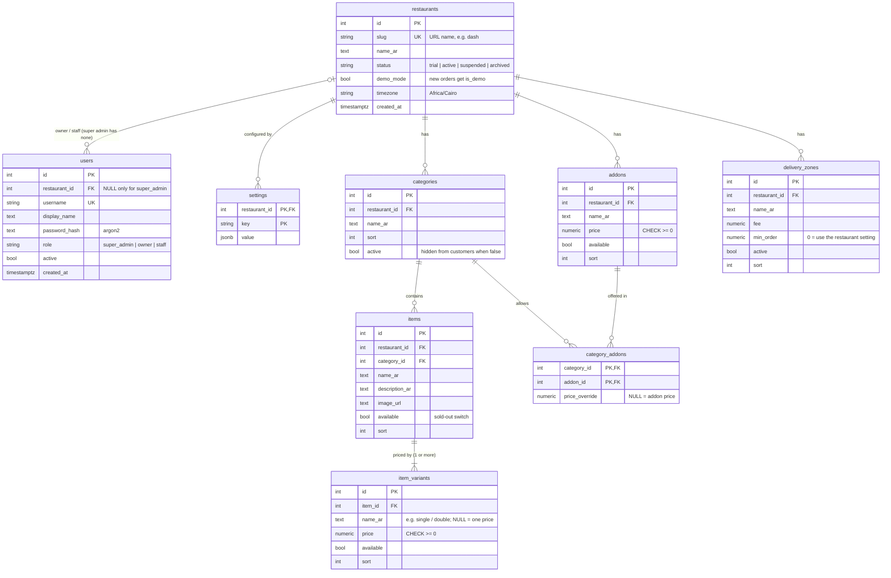
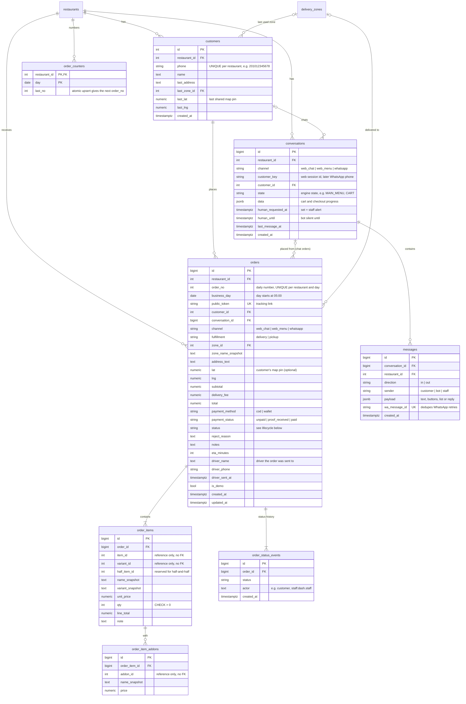
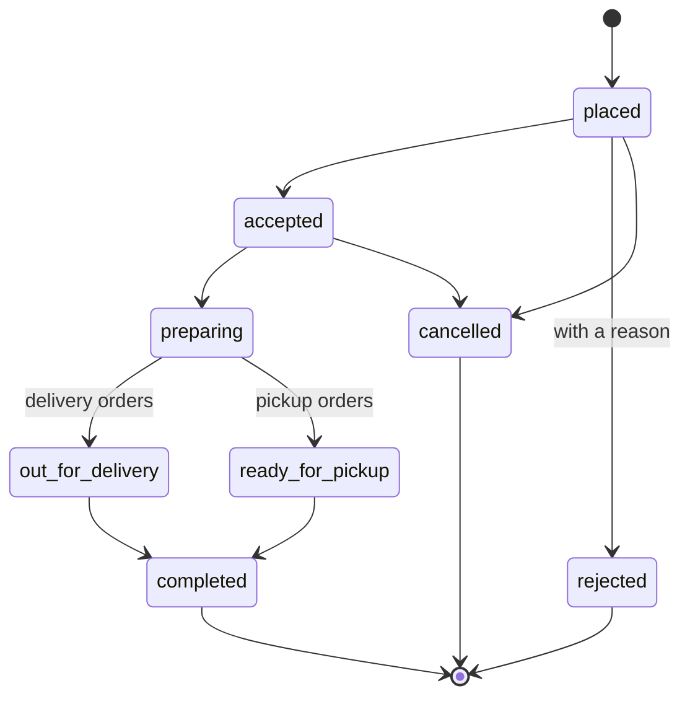
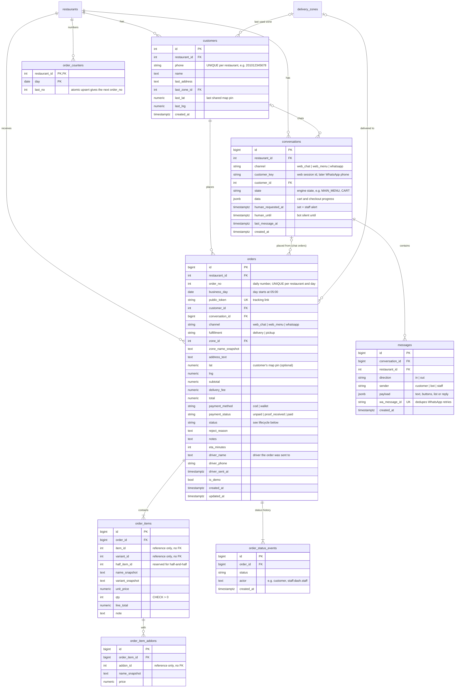

<div align="center">

# منصة الطلبات · Ordering platform

**[العربية](#arabic)** &nbsp;·&nbsp; **[English](#english)**

</div>

<a id="arabic"></a>

# منصة الطلبات (ديمو الويب)

منصة طلبات لأكتر من مطعم. العميل بيطلب من **شات شبه واتساب** أو من **صفحة منيو على الويب**، والطلب بيوصل فورًا على **داشبورد المطعم**، واحنا بندير كل المطاعم من **لوحة الإدارة**. محرك الشات بيستخدم نفس أنواع رسايل واتساب وحدودها، فربط WhatsApp Cloud API بعدين هيبقى إضافة adapter (`backend/app/channels/whatsapp.py`) مش إعادة كتابة.

أول مطعم: **Dash** (الـ slug بتاعه `dash`). المنيو الحالي **تجريبي** متعمل من الأمثلة اللي في خطة المشروع الأصلية؛ يتبدل بالمنيو الحقيقي من محرر المنيو في الداشبورد أو من استيراد Excel.

## الروابط المباشرة

الموقع الحي: **https://ordering-demo-three.vercel.app**

### للعملاء (تتبعت لعملاء المطعم، أو للكلاينت وقت الديمو)

| مين بيستخدمه | هو إيه | الرابط |
| --- | --- | --- |
| العملاء، والكلاينت وقت ديمو البيع (يفتحه من الموبايل أو يعمل scan للـ QR). | **محاكي واتساب.** شكله وطريقته زي بوت واتساب بالظبط: لستات، زراير، سلة، وتأكيد الطلب. بيسأل عن الاسم والموبايل مرة واحدة، وبعدها العميل بيطلب بالضغط. تحديثات الطلب من المطعم بتوصله في الشات. | https://ordering-demo-three.vercel.app/r/dash/chat |
| العملاء اللي بيفضلوا صفحة طلب عادية (ينفع تتحط في إنستجرام/فيسبوك أو QR على الترابيزة). | **صفحة المنيو.** الأقسام، فردي/دبل والإضافات، السلة، توصيل أو استلام، وتأكيد الطلب. | https://ordering-demo-three.vercel.app/r/dash |
| العميل صاحب الطلب. | **صفحة تتبع الطلب.** حالة الطلب لحظة بلحظة (اتبعت ← اتقبل ← بيتجهز ← خرج للتوصيل / جاهز ← اتسلم). الرابط بيطلع لوحده بعد الطلب من صفحة المنيو. | `https://ordering-demo-three.vercel.app/o/<token>` |

أكواد الـ QR لرابط الشات ورابط المنيو موجودة في الداشبورد (تبويب **الإعدادات**) وفي لوحة الإدارة (زرار **إدارة** على كل مطعم).

### للمطعم

| مين بيستخدمه | هو إيه | الرابط |
| --- | --- | --- |
| أصحاب المطاعم، الموظفين، واحنا. | صفحة الدخول لكل اللي ليهم حسابات. | https://ordering-demo-three.vercel.app/login |
| **صاحب المطعم** (`dash`): كل حاجة بما فيها الأسعار والمنيو والإعدادات. **الموظف** (`dash.staff`): الطلبات، الأصناف اللي خلصت، فتح/قفل الاستقبال، والوقت المتوقع. أحسن مكان ليه كمبيوتر الكاشير / شاشة تانية؛ اضغط **تفعيل الصوت** مرة واحدة عشان التنبيه يشتغل. | **داشبورد المطعم.** بورد حي (جديد / في المطبخ / في الطريق-جاهز) مع صوت تنبيه للطلبات الجديدة، زراير قبول/رفض/تغيير الحالة وكل زرار بيبعت رسالة للعميل، سجل الطلبات، المنيو (زرار "خلص" لكل صنف، وتعديل كامل + Excel لصاحب المطعم)، محادثات العملاء مع خانة للرد، والإعدادات (المواعيد، مناطق التوصيل، الرسوم، الدفع). | https://ordering-demo-three.vercel.app/dashboard |

### لينا (فريق المنصة)

| مين بيستخدمه | هو إيه | الرابط |
| --- | --- | --- |
| أصحاب المنصة بس (`admin`). | **لوحة الإدارة.** إضافة مطاعم (مع إمكانية نسخ منيو مطعم تاني)، تغيير الحالة (تجربة / شغال / موقوف / مؤرشف)، إضافة حسابات صاحب المطعم والموظفين، تغيير كلمات السر، الدخول على داشبورد أي مطعم، مسح طلبات الديمو، تصدير كل البيانات، والمسح النهائي (للمؤرشف بس). | https://ordering-demo-three.vercel.app/admin |
| المطورين / أدوات المراقبة. | فحص إن الموقع شغال، بيرجع `{"ok":true}`. | https://ordering-demo-three.vercel.app/api/health |
| المطورين. | مشروع Vercel: النشر، الـ logs، ومتغيرات البيئة. | https://vercel.com/ammars-projects-79cd5d73/ordering-demo |
| المطورين. | مشروع Supabase `ordering-demo`: قاعدة البيانات Postgres. | https://supabase.com/dashboard/project/xzudsfgwwcqahwfulifr |

### الحسابات على الموقع الحي

| يقدر يعمل إيه | الدور | اسم المستخدم |
| --- | --- | --- |
| كل حاجة، على كل المطاعم. | مدير المنصة | `admin` |
| داشبورد Dash، المنيو، الأسعار، الإعدادات، المناطق. | صاحب Dash | `dash` |
| شغل الطلبات اليومي وتوافر الأصناف. | موظف Dash | `dash.staff` |

كلمات السر **مش** متخزنة في الريبو ده ولا في أي مكان كنص عادي؛ أصحابها هما اللي كتبوها. لو حد نسي كلمة السر تتغير من `/admin` ← **إدارة** ← **تغيير كلمة السر**.

### سيناريو الديمو (5 دقايق)

1. على اللابتوب: ادخل بحساب `dash`، افتح الداشبورد، واضغط **تفعيل الصوت**.
2. على موبايل الكلاينت: افتح رابط الشات (أو اعمل scan للـ QR).
3. الكلاينت يطلب ← الطلب يظهر على الداشبورد مع صوت ← اضغط **قبول** ← رسالة القبول تظهر في شات الكلاينت ← **ابدأ التحضير** ← **خرج للتوصيل** / **جاهز للاستلام** ← **تم التسليم**.
4. في التوصيل: الكلاينت يختار شرق أو غرب ويدوس **📍 إرسال الموقع**. على الداشبورد هيظهر **الموقع على الخريطة**، ودوس على اسم الدليفري عشان واتساب يفتح والطلب واللوكيشن جاهزين.
5. وريه تبويب المنيو: علّم على صنف إنه خلص، وهيختفي من البوت فورًا.
6. بعد الميتنج: `/admin` ← Dash ← **مسح طلبات الديمو** لمسح الطلبات التجريبية.

قبل أي ميتنج، افتح الموقع مرة لو مكانش حد استخدمه بقاله أسبوع (Supabase المجاني بيوقف المشاريع اللي مش مستخدمة).

## إزاي بيشتغل

```
backend/app/
  engine/        محرك المحادثة، أنواع الرسايل بحدود واتساب، النصوص العربي
  channels/      قنوات الإرسال: web (دلوقتي) و whatsapp (هيكل جاهز)
  services/      التسعير، الطلبات، المنيو، الإعدادات، المواعيد، الإشعارات، Excel، المطاعم
  routers/       auth, setup, public, chat, dashboard, admin
backend/alembic/ تعديلات قاعدة البيانات (migrations)
backend/seeds/dash.py  منيو Dash التجريبي (+ حسابات التطوير اللوكال)
backend/tests/   اختبارات pytest على Postgres حقيقي
web/             الواجهات: React + Vite + Tailwind (عربي RTL)
api/index.py     مدخل Vercel للـ API          vercel.json  إعدادات Vercel
```

- **أكتر من مطعم (multi-tenant):** كل جدول تابع لمطعم فيه `restaurant_id`، وكل استعلام في الداشبورد متقيد بمطعم المستخدم (أي id تبع مطعم تاني بيرجع 404). "شيل مطعم" معناها إيقاف أو أرشفة؛ المسح النهائي محتاج أرشفة الأول + كتابة الـ slug للتأكيد.
- **الأسعار بتتحسب على السيرفر بس:** السلة فيها ids وكميات بس، والإجمالي بيتحسب تاني من قاعدة البيانات عند التأكيد. الصنف اللي يخلص بيتشال من السلة مع رسالة توضيح.
- **جاهز لواتساب:** كل رسالة من البوت بتتراجع على حدود واتساب (3 زراير، 10 صفوف في اللستة، طول العناوين) قبل ما تتحفظ.
- **مناسب للـ serverless:** حالة المحادثة والقفل لكل عميل في Postgres (صف في `conversations` + `SELECT … FOR UPDATE`)، مفيش worker، والداشبورد والشات بيعملوا polling كل 2–3 ثواني بدل SSE.

## التوصيل: المناطق واللوكيشن والدليفري

- **المناطق:** كل مطعم بيحدد مناطقه بنفسه من **الإعدادات ← مناطق التوصيل**: الاسم، الرسوم، الحد الأدنى، الترتيب، تفعيل/إيقاف، إضافة ومسح. Dash دلوقتي: **شرق 20 ج** و**غرب 30 ج**. العميل بيختار منطقته من لستة، وأي تعديل بيظهر في البوت وصفحة المنيو فورًا. لو مفيش مناطق مفعلة، بتتطبق رسوم التوصيل الثابتة.
- **لوكيشن العميل (اختياري):** في الشات البوت بيبعت رسالة طلب موقع بزرار **📍 إرسال الموقع** (نفس رسالة واتساب `location_request_message`)، والعميل يقدر يبعت موقعه من أيقونة 📍 جنب خانة الكتابة كمان. في صفحة المنيو فيه زرار **📍 حدد موقعي**. بعد اللوكيشن البوت بيسأل عن العمارة والدور والشقة. لو العميل مبعتش لوكيشن، يكتب العنوان عادي. العميل الراجع يقدر يختار «نفس العنوان» وبيتاخد اللوكيشن القديم معاه.
- **الدليفري:** صاحب المطعم بيسجل أسامي وأرقام الدليفري من **الإعدادات ← الدليفري**. على أي طلب توصيل (مقبول / بيتجهز / خرج للتوصيل) هيظهر زرار باسم كل دليفري: بيسجل الطلب عليه، وبيفتح شات واتساب معاه والرسالة جاهزة (رقم الطلب، العميل وموبايله، المنطقة، العنوان، لينك الموقع، الأصناف، والمطلوب تحصيله)، وانت بتدوس إرسال. لو مفيش دليفري متسجلين، زرار واحد بيفتح واتساب وانت تختار الشخص. محتاج واتساب على الجهاز (WhatsApp Desktop أو Web).

## هيكل قاعدة البيانات

PostgreSQL، والتعديلات بتتم بـ Alembic (`backend/alembic/versions/`). المرجع الأساسي هو `backend/app/models.py`. أسماء الجداول والأعمدة بالإنجليزي زي ما هي في الكود. القواعد العامة: كل جدول تابع لمطعم فيه `restaurant_id` (مسح المطعم بيمسح كل بياناته)؛ الفلوس `NUMERIC`؛ الأوقات `timestamptz`؛ الأعمدة اللي بتنتهي بـ `_ar` نص عربي بيظهر للعملاء. الـ Row-level security شغال على كل الجداول (مقفول تمامًا قدام الـ API العام بتاع Supabase، والتطبيق بيتصل بصلاحية صاحب الجداول).

### المطاعم والحسابات والمنيو



### العملاء والمحادثات والطلبات



### قواعد مهمة

- **نسخة من الطلب وقت الطلب (snapshots):** سطور الطلب بتاخد نسخة من اسم الصنف والحجم والأسعار والإضافات وقت الطلب، و`order_items.item_id` / `variant_id` أرقام عادية من غير foreign key. تعديل أو مسح المنيو عمره ما بيغير الطلبات القديمة.
- **اللي بيحصل عند المسح:** مسح مطعم بيمسح كل حاجة تبعه. مسح منطقة توصيل بيخلي `orders.zone_id` و`customers.last_zone_id` فاضيين (NULL)، واسم المنطقة بيفضل محفوظ في `zone_name_snapshot`. مسح محادثة مش بيمسح طلباتها (`conversation_id` بيبقى NULL).
- **قيم مينفعش تتكرر:** `restaurants.slug`، `users.username`، `customers (restaurant_id, phone)`، `conversations (restaurant_id, channel, customer_key)`، `orders (restaurant_id, business_day, order_no)`، `orders.public_token`، `messages.wa_message_id`.
- **رسالة واحدة في المرة لكل عميل:** المحرك بيقفل صف `conversations` (`SELECT … FOR UPDATE`) وهو بيعالج الرسالة.
- **أرقام الطلبات:** `order_counters` بيزيد بعملية واحدة ذرية (`INSERT … ON CONFLICT DO UPDATE … RETURNING`)، فطلبين في نفس اللحظة عمرهم ما ياخدوا نفس الرقم.

### دورة حياة الطلب

متطبقة في `backend/app/services/orders.py`؛ أي انتقال غير اللي في الرسمة بيرجع HTTP 409.



العميل بتوصله رسالة في الشات عند `accepted` (مع الوقت المتوقع)، و`out_for_delivery`، و`ready_for_pickup`، و`rejected` (مع السبب)، و`cancelled`. حالة `completed` بتعلّم الطلبات الكاش إنها اتدفعت.

### مفاتيح `settings` (صف لكل مفتاح لكل مطعم)

| المعنى | مثال | المفتاح |
| --- | --- | --- |
| زرار مفتوح/مقفول في الداشبورد | `true` | `accepting_orders` |
| فترات العمل لكل يوم؛ لو ميعاد القفل قبل ميعاد الفتح يبقى بعد نص الليل | `{"sat": [["12:00","02:00"]], …}` | `working_hours` |
| الوقت المتوقع اللي بيتبعت للعملاء | `35` | `eta_minutes` |
| التوصيل والاستلام متاحين ولا لأ | `true` | `delivery_enabled` / `pickup_enabled` |
| رسوم توصيل ثابتة، بتتستخدم بس لو مفيش مناطق توصيل مفعلة | `20` | `delivery_fee` |
| الحد الأدنى للتوصيل (الحد الأدنى الخاص بالمنطقة له الأولوية) | `0` | `min_order` |
| `cod` (كاش) و/أو `wallet` (محفظة) | `["cod"]` | `payment_methods` |
| رقم المحفظة اللي بيظهر للعميل لو اختار محفظة | `""` | `wallet_number` |
| الطلبات قبل الساعة دي بتتحسب على اليوم اللي قبله | `"05:00"` | `business_day_starts` |
| تليفون المطعم | `""` | `contact_phone` |
| الدليفري اللي بيتبعتلهم الطلبات على واتساب (لحد 20) | `[{"name": "أحمد", "phone": "201011112222"}]` | `drivers` |

أي مفتاح مش موجود بياخد القيمة الافتراضية من `backend/app/services/settings.py`.

### أعمدة JSON

- `conversations.data`: `{"cart": [{"variant_id", "addon_ids", "qty"}], "pending": {…الصنف اللي بيتعمل…}, "fulfillment", "zone_id", "address", "lat", "lng", "payment", "page", "fails", "last_order_id"}`. السلة فيها ids بس؛ الأسعار دايمًا بتتحسب من جداول المنيو.
- `messages.payload`: الرسايل الطالعة `{"type": "text" | "buttons" | "list" | "location_request", …}` بنفس شكل رسايل واتساب التفاعلية (وبتتراجع على حدود واتساب قبل الحفظ)؛ الرسايل الداخلة `{"type": "text", "text"}` أو `{"type": "button_reply" | "list_reply", "id", "title"}` أو `{"type": "location", "latitude", "longitude"}`.

### جداول النظام

| الغرض | الجدول |
| --- | --- |
| عدادات لقفل الدخول بعد المحاولات الغلط وحدود الاستخدام العامة (بدل Redis) | `rate_hits (id, bucket, created_at)` |
| أسرار بتتولد جوه قاعدة البيانات، زي مفتاح توقيع الجلسات | `platform_secrets (key, value)` |
| آخر تعديل اتطبق على قاعدة البيانات | `alembic_version` |

## التشغيل على جهازك

محتاج Python 3.12+، و Node 20+، و PostgreSQL 16+.

```bash
python3 -m venv .venv && .venv/bin/pip install -r requirements-dev.txt
npm --prefix web install
cp backend/.env.example backend/.env
```

Postgres (الريبو ده بيستخدم قاعدة بيانات لوكال على البورت 54329):

```bash
LC_ALL=en_US.UTF-8 pg_ctl -D .pgdata -o "-p 54329 -k /tmp" -l .pgdata/server.log start
createdb -h localhost -p 54329 -U postgres ordering
createdb -h localhost -p 54329 -U postgres ordering_test
```

إنشاء الجداول والبيانات التجريبية، وبعدين شغّل الـ API والواجهة (في تيرمينالين):

```bash
cd backend && ../.venv/bin/alembic upgrade head && ../.venv/bin/python -m seeds.dash && cd ..
.venv/bin/python -m uvicorn app.main:app --app-dir backend --port 8000 --reload
npm --prefix web run dev
```

الواجهة بتفتح على http://localhost:5173 (وبتحول `/api` للبورت 8000). حسابات الدخول للتطوير اللوكال مكتوبة في `backend/.env.example` (موجودة في قاعدة بياناتك اللوكال بس).

## الاختبارات

```bash
cd backend && ../.venv/bin/python -m pytest -q
```

بتشتغل على قاعدة `ordering_test` (بتتمسح وتتبني من الأول كل مرة). بتغطي: طلبات كاملة من الشات، مناطق التوصيل والحد الأدنى، المطعم المقفول، صنف يخلص قبل التأكيد، محاولة التلاعب بالأسعار، الانتقالات الغلط بين حالات الطلب (409)، رسايل العميل، التحويل لموظف، عزل المطاعم عن بعض، الصلاحيات، CSRF، قفل الدخول، دورة حياة المطعم في لوحة الإدارة، الإعداد لأول مرة، استيراد وتصدير Excel، واختبار إن كل رسالة من البوت جوه حدود واتساب.

## النشر (Vercel + Supabase)

مشروع Vercel متوصل بالريبو ده على GitHub:

- **أي push على `main`** ← نشر تلقائي على https://ordering-demo-three.vercel.app
- **أي push على فرع تاني أو pull request** ← بناء تجريبي (preview) له رابط خاص. النسخ التجريبية **مفيهاش قاعدة بيانات** (اتصال Supabase متظبط للـ Production بس)، فهي بتأكد إن البناء سليم بس؛ جرّب الميزات الجديدة على جهازك.
- نشر يدوي من فولدر المشروع لو احتجته: `vercel deploy --prod --scope ammars-projects-79cd5d73`

تعديلات قاعدة البيانات: اعمل migration جديدة بـ Alembic، وبعدين طبّقها على Supabase (الأمر `cd backend && ../.venv/bin/alembic upgrade <current>:head --sql` بيطلع الـ SQL).

الإعداد الحالي: مشروع Supabase اسمه `ordering-demo` (eu-central-1) + مشروع Vercel اسمه `ordering-demo` (الـ functions في `fra1`). مفيش أي سر بيتكتب أو يتنسخ باليد:

- **مفتاح توقيع الجلسات** بيتولد جوه قاعدة البيانات بـ migration (`platform_secrets`)؛ `JWT_SECRET` اختياري.
- **رابط قاعدة البيانات** جاي من ربط Supabase مع Vercel (`POSTGRES_URL`، الـ transaction pooler). أي parameters غريبة في الرابط بتتشال، والـ pooling بيتقفل لوحده على Vercel.
- **أول حساب إدارة** بيتعمل على الموقع الحي: صفحة `/login` بتعرض فورم إعداد لمرة واحدة طالما مفيش مدير منصة. بعدها حسابات أصحاب المطاعم والموظفين بتتضاف من `/admin`.
- **RLS** شغال على كل الجداول، فالـ REST API العام بتاع Supabase مش بيقدر يقرا بيانات التطبيق؛ التطبيق بيتصل بصلاحية صاحب الجداول.

بيئة جديدة من الصفر:

1. اعمل مشروع Supabase وطبّق الجداول (`alembic upgrade head --sql`، أو `alembic upgrade head` برابط `DATABASE_URL` مباشر).
2. ضيف المطاعم والمنيو من غير حسابات: `SEED_SKIP_USERS=1 ENVIRONMENT=production python -m seeds.dash` (أو ارفع المنيو بـ Excel بعدين).
3. اعمل مشروع Vercel واربطه (`vercel project add …` و `vercel link`)، حط `ENVIRONMENT=production`، وبعدين من Supabase ← Integrations ← Vercel اربط المشروع عشان `POSTGRES_URL` يتنقل لوحده.
4. `vercel deploy --prod`، وافتح `/login` واعمل حساب الإدارة فورًا.
5. اختبار سريع: الشات على موبايل، الداشبورد على لابتوب، اطلب، اقبل الطلب، وشوف الشات بيتحدث.

ملاحظات: خطة Vercel المجانية (Hobby) للاستخدام غير التجاري؛ أول ما مطعم يدفع انقلوا لـ Pro (أو شغلوا نفس التطبيق على VPS بـ uvicorn). مشاريع Supabase المجانية بتقف لوحدها بعد أسبوع من غير استخدام.

## الخطوات الجاية (بعد الديمو)

قناة واتساب (ربط `phone_number_id` بالمطعم، التحقق من التوقيع، منع تكرار الرسايل بـ `messages.wa_message_id`، والقوالب بعد 24 ساعة)، روابط دعوة عشان أصحاب المطاعم يحطوا كلمات السر بنفسهم، الدفع بالمحفظة مع صورة التحويل، طباعة بون المطبخ، الإحصائيات، وباقي خطة المشروع الأصلية.

---

<a id="english"></a>

# Ordering platform (web demo) — English

Multi-restaurant ordering platform. Customers order through a **WhatsApp-style chat** or a **web menu page**; orders land on a live **restaurant dashboard**; we manage every restaurant from a **super-admin panel**. The chat engine already speaks WhatsApp's message types and limits, so connecting the WhatsApp Cloud API later is an adapter (`backend/app/channels/whatsapp.py`), not a rewrite.

First restaurant: **Dash** (slug `dash`). Its menu is currently a **sample** built from examples in the original project brief; replace it with the real menu through the dashboard editor or the Excel import.

## Live links

Production: **https://ordering-demo-three.vercel.app**

### For customers (share these with the restaurant's customers / the client during a demo)

| Link | What it is | Who uses it |
|---|---|---|
| https://ordering-demo-three.vercel.app/r/dash/chat | **WhatsApp simulator.** Looks and behaves like the WhatsApp bot: lists, buttons, cart, checkout. Asks for a name and phone once, then the customer orders by tapping. Order updates from the restaurant appear in the chat. | Customers, and the client during a sales demo (open it on a phone or scan the QR code). |
| https://ordering-demo-three.vercel.app/r/dash | **Web menu page.** Browse categories, pick single/double and add-ons, cart, delivery or pickup, checkout. | Customers who prefer a normal ordering page (can be linked from Instagram/Facebook or a QR code on the table). |
| `https://ordering-demo-three.vercel.app/o/<token>` | **Order tracking page.** Live status (sent → accepted → preparing → out for delivery / ready → delivered). The link is generated automatically after a web-menu order. | The customer who placed that order. |

QR codes for the chat and menu links are in the dashboard (**الإعدادات** tab) and in the admin panel (**إدارة** on each restaurant).

### For the restaurant

| Link | What it is | Who uses it |
|---|---|---|
| https://ordering-demo-three.vercel.app/login | Login page for everyone with an account. | Restaurant owners, staff, and us. |
| https://ordering-demo-three.vercel.app/dashboard | **Restaurant dashboard.** Live board (new / in the kitchen / on the way-ready) with a beep for new orders, accept / reject / status buttons that message the customer, order history, menu (sold-out switches; full editing + Excel for owners), customer chats with a reply box, and settings (hours, delivery zones, fees, payment). | **Owner** (`dash`): everything incl. prices, menu and settings. **Staff** (`dash.staff`): orders, sold-out switches, open/closed switch, ETA. Best on the counter PC / second screen; press **تفعيل الصوت** once so the beep works. |

### For us (platform team)

| Link | What it is | Who uses it |
|---|---|---|
| https://ordering-demo-three.vercel.app/admin | **Super-admin panel.** Add restaurants (optionally copying another menu), trial / active / suspended / archived, add owner and staff accounts, reset passwords, "enter" any restaurant's dashboard, clear demo orders, export all data, permanent delete (archived only). | Platform owners only (`admin`). |
| https://ordering-demo-three.vercel.app/api/health | Health check, returns `{"ok":true}`. | Developers / uptime checks. |
| https://vercel.com/ammars-projects-79cd5d73/ordering-demo | Vercel project: deployments, logs, environment variables. | Developers. |
| https://supabase.com/dashboard/project/xzudsfgwwcqahwfulifr | Supabase project `ordering-demo`: the Postgres database. | Developers. |

### Accounts on production

| Username | Role | Can do |
|---|---|---|
| `admin` | super admin | Everything, across all restaurants. |
| `dash` | Dash owner | Dash's dashboard, menu, prices, settings, zones. |
| `dash.staff` | Dash staff | Day-to-day orders and availability. |

Passwords are **not** stored in this repo or anywhere else in plain text; they were typed by their owners. Reset a forgotten password from `/admin` → **إدارة** → **تغيير كلمة السر**.

### Demo script (5 minutes)

1. On a laptop: log in as `dash`, open the dashboard, press **تفعيل الصوت**.
2. On the client's phone: open the chat link (or scan the QR).
3. Client orders → the order appears on the dashboard with a beep → press **قبول** → the acceptance message appears in the client's chat → **ابدأ التحضير** → **خرج للتوصيل** / **جاهز للاستلام** → **تم التسليم**.
4. Delivery: the client picks East or West and taps **📍 إرسال الموقع**. The dashboard shows **الموقع على الخريطة**; tap a driver's name and WhatsApp opens with the order and the pin ready to send.
5. Show the menu tab: mark an item as sold out; it disappears from the bot immediately.
6. Afterwards: `/admin` → Dash → **مسح طلبات الديمو** to clear test orders.

Before a meeting, open the site once if it has been idle for a week (Supabase's free tier pauses idle projects).

## How it works

```
backend/app/
  engine/        state machine, WhatsApp-limited message types, Arabic texts
  channels/      web (now) and whatsapp (stub) delivery adapters
  services/      pricing, orders, menu, settings, hours, notify, excel import, restaurants
  routers/       auth, setup, public, chat, dashboard, admin
backend/alembic/ migrations          backend/seeds/dash.py  Dash sample menu (+ local dev accounts)
backend/tests/   pytest against real Postgres
web/             React + Vite + Tailwind (RTL Arabic)
api/index.py     Vercel serverless entry          vercel.json  Vercel config
```

- **Multi-tenant:** every tenant table carries `restaurant_id`; every dashboard query is scoped to the caller's restaurant (other restaurants' ids return 404). Removing a restaurant means suspend / archive; permanent delete needs archive + typing the slug.
- **Prices are server-side only:** carts hold ids and quantities; totals are recomputed from the DB at confirmation. Sold-out items are removed with an explanation.
- **WhatsApp-ready:** every bot message is validated against WhatsApp limits (3 buttons, 10 list rows, title lengths) before it is stored.
- **Serverless-friendly:** conversation state and the per-customer lock live in Postgres (`conversations` row + `SELECT … FOR UPDATE`), no worker, and the dashboard / chat poll every 2–3 s instead of SSE.

## Delivery: zones, location and drivers

- **Zones:** each restaurant manages its own zones in **الإعدادات → مناطق التوصيل**: name, fee, minimum order, order, on/off, add and delete. Dash now has **East (شرق) 20 EGP** and **West (غرب) 30 EGP**. Customers pick their zone from a list; edits show up in the bot and the menu page immediately. With no active zones, the flat delivery fee applies.
- **Customer location (optional):** in the chat the bot sends a location request with a **📍 إرسال الموقع** button (WhatsApp's `location_request_message`); customers can also share a pin from the 📍 icon next to the message box. The menu page has a **📍 حدد موقعي** button. After a pin the bot asks for building / floor / apartment; without a pin the customer just types the address. Returning customers can pick "same address", which reuses the saved pin.
- **Drivers:** the owner saves driver names and numbers in **الإعدادات → الدليفري**. Every delivery order (accepted / preparing / out for delivery) shows a button per driver: it records the driver on the order and opens a WhatsApp chat with them with the message ready (order number, customer and phone, zone, address, map link, items, amount to collect); you press send. With no saved drivers, one button opens WhatsApp and you pick the contact. Needs WhatsApp on the device (WhatsApp Desktop or Web).

## Database schema

PostgreSQL, managed with Alembic (`backend/alembic/versions/`). The source of truth is `backend/app/models.py`. Conventions: every table a restaurant owns has `restaurant_id` (deleting a restaurant cascades to all of its data); money is `NUMERIC`; timestamps are `timestamptz`; Arabic display text columns end in `_ar`. Row-level security is enabled on every table (deny-all for Supabase's public API; the app connects as the table owner).

### Restaurants, accounts and menu


### Customers, chats and orders



### Rules worth knowing

- **Snapshots:** order lines copy the item name, size, prices and add-ons at order time, and `order_items.item_id` / `variant_id` are plain integers (no foreign key). Editing or deleting the menu never changes past orders.
- **Delete behaviour:** deleting a restaurant cascades to everything it owns. Deleting a delivery zone sets `orders.zone_id` / `customers.last_zone_id` to NULL (the zone name stays in `zone_name_snapshot`). Deleting a chat keeps its orders (`conversation_id` becomes NULL).
- **Uniqueness:** `restaurants.slug`, `users.username`, `customers (restaurant_id, phone)`, `conversations (restaurant_id, channel, customer_key)`, `orders (restaurant_id, business_day, order_no)`, `orders.public_token`, `messages.wa_message_id`.
- **One message at a time per customer:** the engine locks the `conversations` row (`SELECT … FOR UPDATE`) while it handles a message.
- **Order numbers:** `order_counters` is incremented with an atomic `INSERT … ON CONFLICT DO UPDATE … RETURNING`, so two simultaneous orders never get the same number.

### Order lifecycle

Enforced in `backend/app/services/orders.py`; any other transition returns HTTP 409.


The customer gets a chat message on `accepted` (with the ETA), `out_for_delivery`, `ready_for_pickup`, `rejected` (with the reason) and `cancelled`. `completed` marks cash orders as paid.

### `settings` keys (one row per key per restaurant)

| Key | Example | Meaning |
|---|---|---|
| `accepting_orders` | `true` | Open/closed switch on the dashboard |
| `working_hours` | `{"sat": [["12:00","02:00"]], …}` | Ranges per weekday; a close time before the open time means past midnight |
| `eta_minutes` | `35` | Expected time sent to customers |
| `delivery_enabled` / `pickup_enabled` | `true` | Fulfillment options offered |
| `delivery_fee` | `20` | Flat fee, used only when the restaurant has no active zones |
| `min_order` | `0` | Delivery minimum (a zone's own minimum takes precedence) |
| `payment_methods` | `["cod"]` | `cod` and/or `wallet` |
| `wallet_number` | `""` | Shown to customers who pick wallet |
| `business_day_starts` | `"05:00"` | Orders before this hour count for the previous day |
| `contact_phone` | `""` | Restaurant phone |
| `drivers` | `[{"name": "أحمد", "phone": "201011112222"}]` | Delivery drivers orders are sent to on WhatsApp (up to 20) |

Missing keys fall back to the defaults in `backend/app/services/settings.py`.

### JSON columns

- `conversations.data`: `{"cart": [{"variant_id", "addon_ids", "qty"}], "pending": {…item being built…}, "fulfillment", "zone_id", "address", "lat", "lng", "payment", "page", "fails", "last_order_id"}`. The cart holds ids only; prices are always recomputed from the menu tables.
- `messages.payload`: outgoing `{"type": "text" | "buttons" | "list" | "location_request", …}` in the same shape as WhatsApp interactive messages (validated against WhatsApp limits before saving); incoming `{"type": "text", "text"}`, `{"type": "button_reply" | "list_reply", "id", "title"}` or `{"type": "location", "latitude", "longitude"}`.

### System tables

| Table | Purpose |
|---|---|
| `rate_hits (id, bucket, created_at)` | Sliding-window counters for the login lockout and public rate limits (replaces Redis) |
| `platform_secrets (key, value)` | Secrets generated inside the database, e.g. the session signing key |
| `alembic_version` | Current migration |

## Local development

Requires Python 3.12+, Node 20+, PostgreSQL 16+.

```bash
python3 -m venv .venv && .venv/bin/pip install -r requirements-dev.txt
npm --prefix web install
cp backend/.env.example backend/.env          # local-only values + dev seed accounts
```

Postgres (this repo uses a project-local cluster on port 54329):

```bash
LC_ALL=en_US.UTF-8 pg_ctl -D .pgdata -o "-p 54329 -k /tmp" -l .pgdata/server.log start
createdb -h localhost -p 54329 -U postgres ordering
createdb -h localhost -p 54329 -U postgres ordering_test
```

Schema + seed, then run the API and the web app (two terminals):

```bash
cd backend && ../.venv/bin/alembic upgrade head && ../.venv/bin/python -m seeds.dash && cd ..
.venv/bin/python -m uvicorn app.main:app --app-dir backend --port 8000 --reload
npm --prefix web run dev                      # http://localhost:5173 (proxies /api to :8000)
```

Local development login accounts are listed in `backend/.env.example` (they exist only in your local database).

## Tests

```bash
cd backend && ../.venv/bin/python -m pytest -q
```

Runs against the `ordering_test` database (dropped and migrated on each run). Covers full chat orders, delivery zones and minimums, closed hours, sold-out-before-confirm, price tampering, lifecycle 409s, customer notifications, human handoff, tenant isolation, roles, CSRF, login lockout, admin lifecycle, first-run setup, Excel import/export, and a contract test that every bot message fits WhatsApp's limits.

## Deploy (Vercel + Supabase)

The Vercel project is connected to this GitHub repo:

- **Push to `main`** → automatic production deploy to https://ordering-demo-three.vercel.app
- **Push to any other branch / open a PR** → automatic preview build with its own URL. Previews have **no database** (the Supabase connection is set for Production only), so they only show that the build works; use local development to test features.
- Manual deploy from the repo root, if ever needed: `vercel deploy --prod --scope ammars-projects-79cd5d73`

Schema changes: add an Alembic migration, then apply it to Supabase (`cd backend && ../.venv/bin/alembic upgrade <current>:head --sql` gives the SQL).

Current setup: Supabase project `ordering-demo` (eu-central-1) + Vercel project `ordering-demo` (functions in `fra1`). No secret is ever typed or copied by hand:

- **Session signing key** is generated inside the database by a migration (`platform_secrets`); `JWT_SECRET` is optional.
- **Database URL** comes from the Supabase → Vercel integration (`POSTGRES_URL`, transaction pooler). Unknown query params are stripped and pooling is disabled automatically on Vercel.
- **First admin account** is created on the live site: `/login` shows a one-time setup form while no super admin exists. Restaurant owners/staff are then added from `/admin`.
- **RLS** is enabled on every table, so Supabase's public REST API cannot read app data; the app connects as the table owner.

Fresh environment from scratch:

1. Create a Supabase project and apply the schema (`alembic upgrade head --sql`, or `alembic upgrade head` with a direct `DATABASE_URL`).
2. Seed restaurants/menus without accounts: `SEED_SKIP_USERS=1 ENVIRONMENT=production python -m seeds.dash` (or load menus with the Excel import later).
3. Create and link the Vercel project (`vercel project add …`, `vercel link`), set `ENVIRONMENT=production`, then in Supabase → Integrations → Vercel connect the project so `POSTGRES_URL` is synced.
4. `vercel deploy --prod`, open `/login` and create the admin account right away.
5. Smoke test: chat on a phone, dashboard on a laptop, place an order, accept it, watch the chat update.

Notes: Vercel Hobby is for non-commercial use — move to Pro (or run the same app on a VPS with uvicorn) once a restaurant pays. Supabase free projects pause after a week idle.

## Next (after the demo)

WhatsApp channel (map `phone_number_id` → restaurant, verify signatures, dedupe on `messages.wa_message_id`, templates outside the 24 h window), invite links so restaurant owners set their own passwords, wallet screenshot flow, kitchen ticket printing, analytics, and the rest of the original roadmap.
